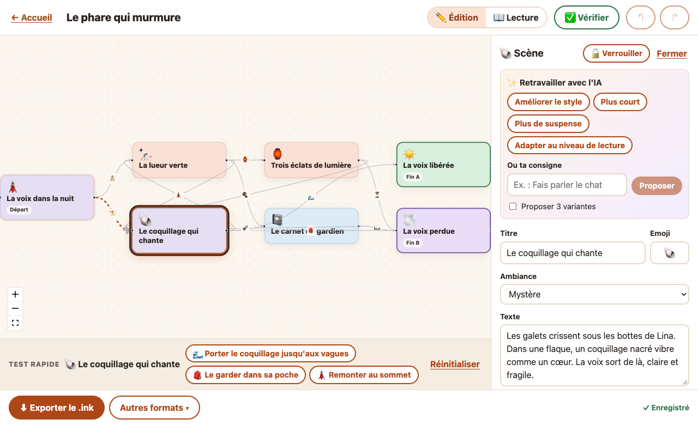
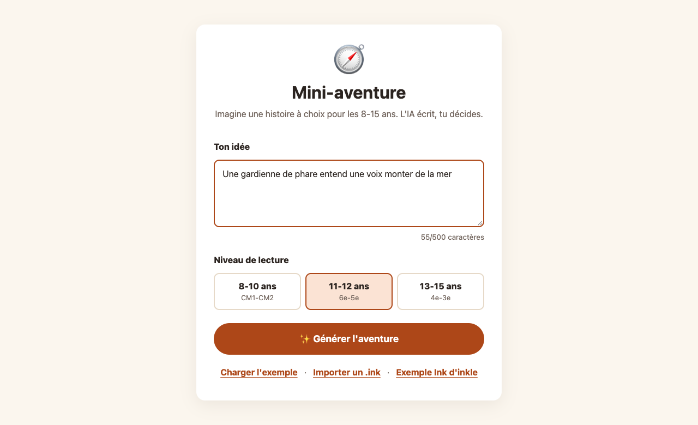
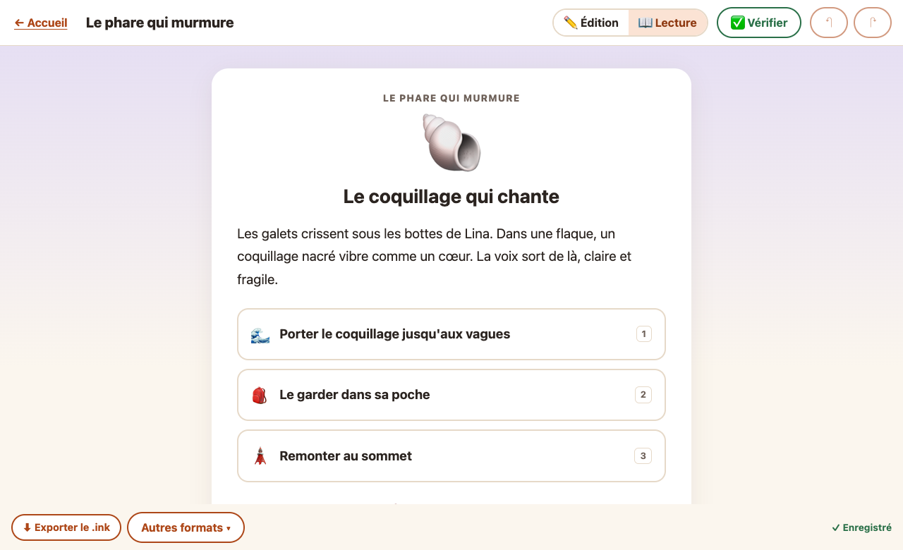
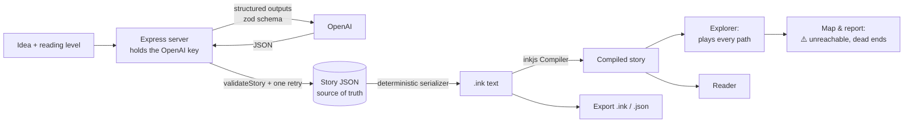

# Mini-aventure

A local web app to create short interactive adventures for readers aged 8 to 15, in the [Ink](https://www.inklestudios.com/ink/) format. An author types an idea, an LLM (OpenAI) drafts the story, and the author edits it on a visual map, plays it, checks that every scene and both endings are reachable, and exports it as `.ink`.

> The interface and the generated stories are in French. The code, its comments and this documentation are in English.

**Guiding principle: the LLM proposes, the code verifies, the author decides.**

<p align="center">
  
  <br>
  <em>The editor: each scene is a card, each choice an arrow. The quick test lights up the path taken, and the side panel edits the selected scene or reworks it with the AI.</em>
</p>

<table>
  <tr>
    <td width="50%" align="center" valign="top">
      
      <br>
      <strong>Create</strong><br>
      <em>An idea, a reading level (8-10, 11-12, 13-15), and the AI drafts the story. Or load the built-in example.</em>
    </td>
    <td width="50%" align="center" valign="top">
      
      <br>
      <strong>Read</strong><br>
      <em>The Reader plays the compiled Ink: big emoji, text, choices as buttons (mouse or keys 1-9), both endings.</em>
    </td>
  </tr>
</table>

## Quick start

Requirements: **Node.js 20.19+** (or 22.12+) with npm 10+, `make` (preinstalled on macOS and Linux), and an OpenAI API key (only needed to generate or rewrite with the AI; everything else works without one).

```bash
make install   # install all dependencies (npm workspaces)
make env       # create server/.env from server/.env.example (never overwrites an existing file)
```

Open `server/.env` and paste your key:

```dotenv
OPENAI_API_KEY=sk-...
OPENAI_MODEL=gpt-5.4-mini   # any model that supports structured outputs
```

`server/.env` is ignored by git. The key is read by the server only and is never sent to the browser. `OPENAI_MODEL` sets the model for generation and rewrites (if empty, `gpt-5.4-mini`). It is read at startup, so restart `make dev` after changing it. The server logs the model in use: `API prête sur http://localhost:3001 (modèle : …)`.

```bash
make dev       # API on port 3001 + app on http://localhost:5173
```

Open **http://localhost:5173**. Without a key, the server still starts (it logs `Clé manquante : renseigne server/.env`) and the home screen says so. You can still load the examples, edit, play, import and export.

| Command                                  | What it does                               |
| ---------------------------------------- | ------------------------------------------ |
| `make help`                              | List the commands                          |
| `make install` / `make env` / `make dev` | Install, create `server/.env`, run         |
| `make test`                              | Unit tests (Vitest, 164 tests, no network) |
| `make lint` / `make format`              | ESLint / Prettier                          |
| `make build`                             | Type-check both apps and build the client  |
| `make clean`                             | Remove `node_modules` and build outputs    |

## 2-minute demo

1. **Create**: on the home screen, click **« Charger l'exemple »**. It opens the built-in story « Le phare qui murmure » with no API call. With a key, you can instead type an idea, pick a reading level and click **« ✨ Générer l'aventure »** (10 to 20 s).
2. **Map**: each scene is a card (mood colour; ending A in green, ending B in purple) and each choice is an arrow. **« ✅ Vérifier »** shows the report: 7/7 scenes and 2/2 endings reached.
3. **Break it on purpose**: click « Le coquillage qui chante », and in « Mène à » send « Porter le coquillage jusqu'aux vagues » to « La voix perdue (fin B) ». Within 0.3 s, ending A turns grey and dashed (« Inaccessible »), the button turns « ⚠️ Vérifier », and the report says « Fins atteintes : 1/2 ». Press **Ctrl+Z** (Cmd+Z), and everything is back.
4. **Rework with the AI** (needs a key): in the same panel, click **« Plus de suspense »** (tick « Proposer 3 variantes » if you like). Compare the before/after preview, click **« Garder »**, then Ctrl+Z to undo. The arrows never move: the AI only rewrites the words.
5. **Read**: switch to **📖 Lecture**. The Reader plays the compiled Ink, not the JSON. Reach both endings with the mouse or the keys 1-9, and watch « Fins découvertes : 2/2 ».
6. **Export / import**: **« ⬇ Exporter le .ink »** (or « Autres formats » → compiled `.json`, or « Voir le code Ink »). Back on the home screen, **« Importer un .ink »** that file, or open **« Exemple Ink d'inkle »**: text mode, with the code on the left, the player on the right, and the explorer's results.

## Features

- **Generation** with OpenAI structured outputs. The story is JSON that must match a zod schema, with a plan written first. It has 4 to 6 scenes plus 2 endings, an introductory first scene, and a transition sentence for every choice. It is adapted to three reading levels (8-10, 11-12, 13-15) with content suitable for minors.
- **Map editor** (React Flow): edit titles, emojis, moods, texts and choices; add or delete choices and scenes; lock a scene 🔒. A **quick test** under the map lets you click through the story and lights up the path.
- **Live checks**, about 0.3 s after each change: structure (`validateStory`), Ink compilation (inkjs), and a **reachability explorer** that plays every path. Problems warn, they never block.
- **✨ Rewrite a scene with the AI**: quick actions or a free instruction, 1 or 3 proposals, a before/after preview, then keep (undoable) or cancel.
- **Reader**: plays the compiled Ink, with a big emoji, the text, choice buttons, both endings, « Rejouer » and « Fins découvertes : x/2 ». It can start from any scene (« ▶ Jouer depuis ici »), and switching between Édition and Lecture keeps the scene.
- **Export**: `.ink`, compiled `.json` (for ink runtimes), and a code viewer with Copy. **Import**: any `.ink` in text mode (edit, play, explore).
- **Undo/redo** (Ctrl+Z / Ctrl+Shift+Z, typing grouped into one step) and **autosave** in the browser, with « Reprendre ton aventure » after a refresh.
- **Accessibility**: real buttons, full keyboard use (a scene list as the keyboard alternative to the map, number keys in the Reader, visible focus), `aria-live` on the story text, emojis hidden from screen readers, WCAG AA contrast, reduced motion respected. axe-core reports no violations on any screen.

## Architecture



- **The LLM never writes Ink.** It returns JSON that must match a strict schema (`shared/schema.ts`). The API guarantees the shape, and our code checks the content.
- **The JSON is the single source of truth.** The map, the checks, the Reader and the exports are all derived from it. A **deterministic serializer** (`client/src/lib/inkSerializer.ts`) turns it into Ink, escaping every author or LLM text so it can never be read as Ink syntax. The Ink always compiles, even mid-edit: a missing target becomes `-> END` and a warning.
- **Two independent checks, neither of them asked to the LLM**:
  - **structure**, on the JSON (`shared/validate.ts`): ids, Ink reserved words, targets, exactly two endings, counts, emojis, plus a graph search (every scene reachable, an ending reachable from every scene). The server uses it to retry the LLM, and the editor shows it live;
  - **reachability**, on the compiled Ink (`client/src/lib/explorer.ts`): a depth-first search that saves and restores the inkjs state at each choice, skips decision points already explored (that is what ends loops), and has a step and depth budget. Because it plays the compiled Ink, it also works on imported `.ink` files.
- **The Reader plays the Ink**, not the JSON. Scene metadata travels as Ink tags (`# scene:`, `# scene_title:`, `# emoji:`, `# mood:`, `# ending:`, `# ending_label:`), so if a story plays in the Reader, the exported `.ink` works.

Excerpt of the generated Ink ([full example](examples/le-phare.ink)):

```ink
=== crique ===
# scene: crique
# scene_title: Le coquillage qui chante
# emoji: 🐚
# mood: mystere
Les galets crissent sous les bottes de Lina. …
+ [Porter le coquillage jusqu'aux vagues #emoji: 🌊] Lina serre le coquillage contre elle et avance dans l'écume.
  -> fin_lumiere
+ [Le garder dans sa poche #emoji: 🎒] Lina glisse le coquillage dans sa poche et s'assoit sur un rocher.
  -> fin_brume
+ [Remonter au sommet #emoji: 🗼] Lina remonte au sommet, le cœur battant.
  -> sommet
```

Each choice carries an **outcome**, the sentence after `]`, which Ink prints right after the click. A scene reached by several choices stays neutral, and each choice's outcome makes its own transition into it. The Reader shows it in italics above the next scene. Without it, a shared scene could only follow from one of the choices leading to it.

### Project layout

```
shared/   used by both sides, imported as @shared/*: zod schemas, validateStory, emojis, API contract
server/   Express (holds the key): /api/health, /api/generate, /api/rewrite; prompts; OpenAI calls
client/   Vite + React: screens (Create, Editor, Reader, Import), lib (serializer, compiler, explorer,
          layout, player, edits), state (store with undo, autosave)
examples/ built-in story (.json + generated .ink) and the public inkle example
docs/     design notes (01, 02), deviations from the spec (03), one doc per step (steps/)
```

### API

| Route                | Body                                                                   | Response                                                  |
| -------------------- | ---------------------------------------------------------------------- | --------------------------------------------------------- |
| `GET /api/health`    |                                                                        | `{ ok: true, openaiKey: boolean }` (never the key itself) |
| `POST /api/generate` | `{ idea: string (1-500), readingLevel: "8-10" \| "11-12" \| "13-15" }` | `{ story, warnings }`, or `{ error }` in French           |
| `POST /api/rewrite`  | `{ story, sceneId, instruction (1-300), variants: 1 \| 3 }`            | `{ variants }`: the words only, never the choice targets  |

**Generation** (`server/src/generate.ts`):

1. Call the model (`gpt-5.4-mini` by default, reasoning effort `low`).
2. Fix emojis.
3. Run `validateStory`.
4. If there are issues, retry **once** with the exact issues and the list of scenes that exist.
5. If issues remain, return the story **with warnings** when the editor can fix them all (e.g. a choice to a scene that does not exist), otherwise return a clear 422.

Duration and tokens are logged. A generation costs about 1 cent and takes 5 to 20 s.

## Design decisions and trade-offs

| Decision                                                                                 | Rejected alternative                           | Trade-off accepted                                                                                                                                                       |
| ---------------------------------------------------------------------------------------- | ---------------------------------------------- | ------------------------------------------------------------------------------------------------------------------------------------------------------------------------ |
| The LLM returns **JSON**, which code turns into Ink                                      | The LLM writes Ink                             | Guaranteed structure and no syntax errors; in exchange, no Ink variables or conditions, which a mini-adventure does not need                                             |
| **JSON = source of truth** in the editor, Ink = output                                   | Ink as the only source                         | Visual editing is possible; in exchange, an imported `.ink` opens in **text mode** (no map), because rebuilding our structure from arbitrary Ink is a project of its own |
| Structure is checked **by code**: graph search on the JSON, explorer on the compiled Ink | Asking the LLM "is everything reachable?"      | An LLM can be wrong with confidence. Our very first real generation had an ending no choice led to, and the code caught it                                               |
| **zod** as the single definition of the data model                                       | Separate TS types + JSON schema + validation   | One change updates the types, the runtime checks and the strict schema sent to OpenAI                                                                                    |
| A rewrite schema with **no target field**                                                | Let the AI return the whole scene and check it | The AI cannot move an arrow even if the check were wrong: impossible by construction                                                                                     |
| After the retry, **return fixable issues as warnings** instead of failing                | Always fail with an error                      | The author repairs one wrong arrow in two clicks instead of losing the story ("the author decides"); issues the editor cannot fix still fail                             |
| **Emojis** as illustrations, stored as Ink tags                                          | Generated images                               | Free, instant and editable; rendering varies by system                                                                                                                   |
| Columns by depth for the map                                                             | A layout library (dagre)                       | Predictable and enough for 6 to 10 scenes; nodes cannot be dragged                                                                                                       |
| Autosave in **localStorage** only                                                        | Server storage, accounts                       | Nothing to set up; one story per browser                                                                                                                                 |

Every difference with the original spec, and why, is in [`docs/03-deviations.md`](docs/03-deviations.md). Each step's details (what was built, tests, limits) are in [`docs/steps/`](docs/steps/).

## Testing

- **`make test`** runs 164 unit tests, with no network and no cost:
  - serializer (every escaping rule as a compile-and-play round trip);
  - compiler wrapper;
  - explorer (loops, orphans, dead ends, imported Ink, depth guard);
  - `validateStory` (including a real LLM answer kept as a regression fixture);
  - generation and rewrite workflows with a **fake model** (retry, warnings, locked scene, structure checks);
  - undo history, autosave, layout, edits, player, import/export.
- **In the browser**, each step was also checked end to end with Playwright driving Chrome (scripts kept outside the repo): the acceptance scenarios of steps 5 to 10, an axe-core accessibility audit of every screen, and a keyboard-only scenario.
- **Real OpenAI calls** were kept few and logged in the step docs: about 10 calls in total, around 9 cents.

## Built with AI, and how it was checked

- **Spec**: the design documents ([`docs/01-recap-cadrage.md`](docs/01-recap-cadrage.md), [`docs/02-prompt-implementation.md`](docs/02-prompt-implementation.md)) were provided by the author before any code was written.
- **Code, tests and documentation** were written by **Claude Code** (Anthropic's AI coding assistant), one step at a time following `docs/02`, under the author's direction.
- **Decisions taken by the author** along the way:
  - English for code, comments, commits and docs;
  - one doc per step, and a deviations document;
  - a Makefile;
  - adopting zod;
  - each budget for real API calls;
  - for generations that stay invalid: list the existing scenes in the retry, and let the author fix the remaining issues in the editor;
  - keeping the compiled `.json` export.
- **How each step was verified** before the author reviewed and committed it: type checking, lint, unit tests, browser scenarios, and real API calls where useful.
- **What the author caught while testing** (fixed, documented in `docs/03-deviations.md`): stories that started without introducing the hero, and choices whose next scene did not follow from them, because a scene shared by several paths only followed one of them. Both were fixed in the prompt and the data model.
- **What these checks caught** (all fixed, all documented in `docs/03-deviations.md`):
  - an escaping rule (`\/*` still opens an Ink comment) and Ink choice tags that only work inside the brackets;
  - LLM stories with an unreachable ending or a choice to a non-existent scene (hence the graph checks, the scene list in the retry, a little reasoning, and warnings);
  - an ending that jumped outside the visible map;
  - arrow labels stealing clicks;
  - an endings counter one render late;
  - a prototype explorer that overflowed the call stack on a complex imported story (reverted, depth guard added);
  - colour contrast below WCAG AA.

## Known limitations and next steps

- **Not done from the spec's bonus list**: an AI coherence review (⚠️ on the map with « Corriger avec l'IA »), and « Changer d'idée » (regenerate what follows a scene).
- **Imported Ink with state** (variables, read counts) is explored approximately: a branch that only opens under a condition can be missed. The screen says so.
- No map for imported files, and no way to turn them back into our JSON format.
- The edit panel cannot turn a scene into an ending or change the start scene (they come from generation). This is why the start scene and the two endings can be edited but not deleted.
- Quality rules that are not structural (sentence length, no repeated emoji) are asked of the LLM but not measured.
- On dense maps, arrow labels can overlap. Nodes cannot be dragged.
- The JS bundle is over 500 kB (the inkjs compiler plus React Flow). This is fine locally, and code splitting is a possible follow-up.
- Possible next steps: the two missing AI features, optional illustrations on demand, sharing a story as a link, and a smarter explorer for stateful Ink.

## Examples and their sources

| File                                                                                 | What it is                                                                                                                                 | Source and license                                                                                                                                                                                                                                |
| ------------------------------------------------------------------------------------ | ------------------------------------------------------------------------------------------------------------------------------------------ | ------------------------------------------------------------------------------------------------------------------------------------------------------------------------------------------------------------------------------------------------- |
| [`examples/le-phare.json`](examples/le-phare.json) / [`.ink`](examples/le-phare.ink) | Built-in story « Le phare qui murmure » (5 scenes, 2 endings, one loop). The `.ink` is generated from the JSON and kept in sync by a test. | Written for this project.                                                                                                                                                                                                                         |
| [`examples/monsieur-fogg.ink`](examples/monsieur-fogg.ink)                           | « A conversation with nested nodes », copied verbatim from inkle's _Writing with ink_. Weave syntax, no knots, one ending.                 | [inkle/ink, Documentation/WritingWithInk.md](https://github.com/inkle/ink/blob/4011b8c0a01828c61dd2331613c1038a3a5f294b/Documentation/WritingWithInk.md#example-a-conversation-with-nested-nodes), **MIT License**, Copyright (c) 2025 inkle Ltd. |
